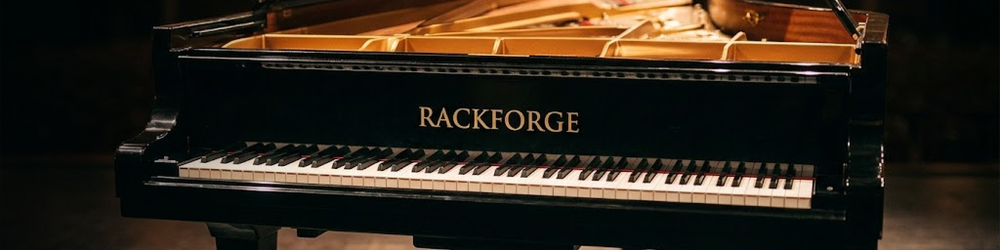

# Concert Grand for RackForge

Concert Grand is a physically modeled acoustic piano for RackForge. It has 16 factory voicings, from concert and parlour grands to uprights and a Viennese fortepiano. You can shape the piano, move the virtual microphones, and save your own voicings from the PLAY panel.

## Get playing

Concert Grand comes bundled with RackForge Standard. [Download RackForge](https://github.com/kalexis1994/rackforge/releases/latest)

To install or update the piano separately, download `RF-Concert-Grand.rfplugin` and choose **Install plugin** in RackForge's Plugin Manager. [Download Concert Grand](https://github.com/kalexis1994/rackforge-plugin-concert-grand/releases/latest)

1. Open **PLAY** and choose **RF - Concert Grand**.
2. Play from a MIDI keyboard or RackForge's **Touch Controller**.
3. Start with the **Concert Grand** voicing. Click the brass nameplate to search the voicings or use the arrows to step through them.

## How the piano responds

The piano generates each note as you play. A soft strike sounds rounder, while a harder strike brings out a brighter attack. The soundboard gives the vibrating strings their body. On damped notes, releasing the key brings the damper back onto the strings. Hold the sustain pedal and the notes ring on, with other strings resonating in response.

| Pedal | What you hear |
| --- | --- |
| **Sustain** (MIDI CC 64) | Lets notes keep ringing after you release the keys. A continuous pedal lets you use half-pedaling to shorten the ring gradually. |
| **Sostenuto** (MIDI CC 66) | Holds the notes you were already playing when you pressed the pedal. Notes played afterward release normally when sustain is up. |
| **Soft / una corda** (MIDI CC 67) | Softens the attack and changes the tone of notes you strike while the pedal is down. |

## Choose a voicing

- **Concert Grand** is the starting sound. Try **Mellow Grand** for a softer attack, **Bright Grand** for more bite, or **Intimate Grand** for a close, narrow perspective.
- **Concert 308**, **Salon 211**, and **Baby 150** give you different grand-piano scales. Play the same bass phrase on each to hear how the body and sustain change.
- **Upright 114** is close and dry. **Player Upright** has a harder attack and the sound of a worn, slightly out-of-tune instrument. **Fortepiano** offers a lighter, period-piano character.

## Shape and save your sound

| Panel | Controls to start with |
| --- | --- |
| **Sound** | Use **Brightness** to set the tone, **Dynamics** to shape the response to your touch, **Decay** to adjust the length of the ring, and **Level** to set the piano's output. |
| **Room & Microphones** | Adjust **Mic Distance**, **Stereo Width**, and **Ambience Level** to move from a close perspective to a roomier sound. **Lid** changes how open the piano sounds. |
| **Action & Noises** | Balance the sounds of the moving keys, note releases, and pedals with **Action Noise**, **Release Noise**, and **Pedal Noise**. |

Choose **+ Save current** in **Voicings**, give your sound a name, and confirm. It appears under **Saved** in the nameplate selector alongside the factory voicings.

## License

Concert Grand is available under the GNU GPL v2 or later. [License](LICENSE) and [third-party notices](NOTICE.md).
